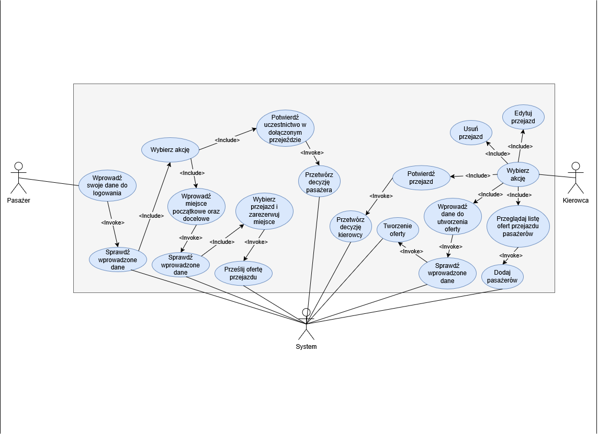

# Diagram przypadków użycia

# Logowanie użytkownika
Opis: Pasażer loguje się do systemu, aby uzyskać dostęp.
Aktor: Pasażer
Warunki wstępne: Pasażer musi się znajdować się na stronie logowania.
Scenariusz główny: 
- Pasażer wprowadza dane logowania.
- System weryfikuje wprowadzone dane.
- System tworzy sesję dla użytkownika.
Scenariusz alternatywny:
- Błędne hasło -> System wyświetla komunikat o błędzie i nie wpuszcza pasażera dalej.
Efekt końcowy: Sesja jest aktywna.

# Tworzenie oferty przejazdu
Opis: Kierowca tworzy ofertę przejazdu.
Aktor: Kierowca
Warunki wstępne: Kierowca musi być zalogowany, aby utworzyć ofertę.
Scenariusz główny:
- Kierowca wprowadza potrzebne dane do utworzenia oferty.
- System weryfikuje, czy dana trasa jest możliwa do zrealizowania.
- System tworzy grupę do której pasażerowie mogą dołączyć.
Scenariusze alternatywne:
- Błędna nazwa miejsca docelowego lub początkowego -> System wyświetla błąd i daje kierowcy możliwość do poprawy
